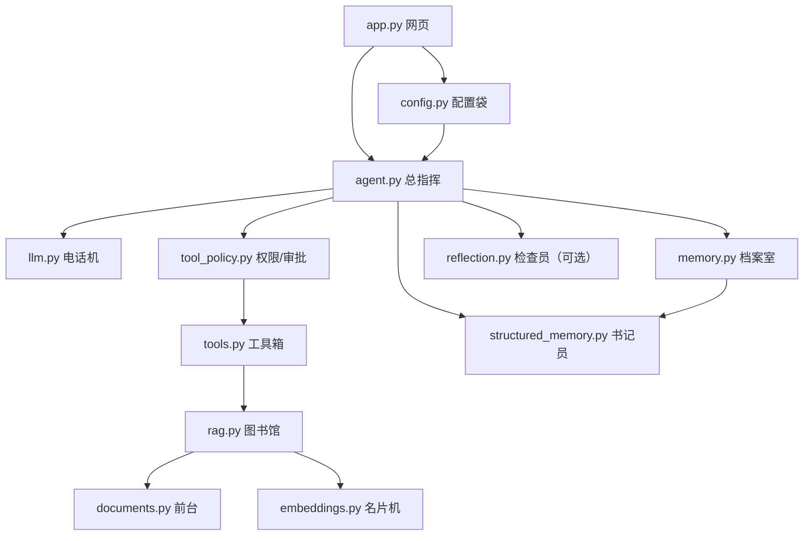

# 代码阅读导航：跟着一轮聊天把项目看懂（大白话版）

这组文档写给刚接触 Python 和 Agent 的你。不用先记住 ORM、RAG、闭包这些词——用到时文档里会顺手解释，还尽量用比喻讲。

**想先看整个项目怎么流转？** 打开 [交互式项目全景图](D:/study/AI/ai-agent-demo-study/docs/code-guide/project-map.html)：14 条链路可切换，点模块看调用，展开函数看步骤和真实源码。[读图方法](D:/study/AI/ai-agent-demo-study/docs/code-guide/project-map.md) 单独放在这里，图本身用浏览器即可打开。

每篇的套路一样：**一句话定位（这个文件是谁、管什么）→ 逐个函数拆（它收什么、干什么、交回什么、为什么这样写）→ 完整例子串一遍 → 三句话带走**。开读前建议先跑一遍网页（启动方法看 [项目 README](D:/study/AI/ai-agent-demo-study/开发文档.md)），有个体感再对照源码。

## 1. 先用一个例子打底

你在网页问："计算 (12+8)*3。"

```text
app.py 网页收到问题
    → agent.py 总指挥：读最近聊天 + 用户画像
    → 程序直接调用知识库，先强制查一次（计算题也查，保底动作）
    → 模型看到资料不够用，递单子："请调用 calculator"
    → Python 真的算出 60，结果塞回给模型
    → 模型写出草稿；开启 Reflection 时先检查，有问题才重写一次
    → 另发一次请求：这轮有没有值得记的个人事实？
    → 回答完成后看最后一次主问答总 token，超过 50000 时按需摘要
    → memory.py 同一个事务保存问答+轨迹（+画像变化）
    → 网页重新读库，展示答案、工具轨迹、本轮用量和当前会话累计
```

两个贯穿全项目的观念，先立住：

1. **模型只会"说"，做事全靠 Python**。它递"要用计算器"的单子，真的按键的是你电脑上的函数；
2. **模型天生失忆**。数据库里有你的记录 ≠ 模型自动知道——每轮都要程序翻出来、塞进这次的输入里。

后面每篇文档都在回答："这个函数在这条流水线的哪一站？"

## 2. 各篇的读法和各自的"人设"

源码都在 `D:/study/AI/ai-agent-demo-study/agent_demo/`。建议 PyCharm 左边开源码、右边开文档，按函数名对照。

| 顺序 | 文件 | 人设比喻 | 读完你能回答 |
| --- | --- | --- | --- |
| 1 | [__init__.py](D:/study/AI/ai-agent-demo-study/docs/code-guide/__init__.md) | 工具箱封条 | `from agent_demo...` 凭什么找得到代码？ |
| 2 | [config.py](D:/study/AI/ai-agent-demo-study/docs/code-guide/config.md) | 传达室大爷 | 密钥、数据库地址、"历史看几轮"从哪来？ |
| 3 | [llm.py](D:/study/AI/ai-agent-demo-study/docs/code-guide/llm.md) | 装好密钥的电话机 | "造客户端"和"真提问"差在哪？ |
| 4 | [tools.py](D:/study/AI/ai-agent-demo-study/docs/code-guide/tools.md) | 四件工具的工具箱 | 模型怎么让本地 Python 帮它干活？计算器为什么不敢直接 eval？ |
| 5 | [tool_policy.py](D:/study/AI/ai-agent-demo-study/docs/code-guide/tool_policy.md) | 工具门卫与审批员 | 工具怎么被允许、限次、暂停等人工批准？ |
| 6 | [documents.py](D:/study/AI/ai-agent-demo-study/docs/code-guide/documents.md) | 仓库前台 | PDF/Word/TXT 怎么汇成同一条入库路线？ |
| 7 | [embeddings.py](D:/study/AI/ai-agent-demo-study/docs/code-guide/embeddings.md) | 发数字名片的翻译官 | 换个说法，为什么还能找到同一段资料？ |
| 8 | [rag.py](D:/study/AI/ai-agent-demo-study/docs/code-guide/rag.md) | 图书馆管理员 | 文档怎么切片、重启为什么不重复花钱向量化？ |
| 9 | [memory.py](D:/study/AI/ai-agent-demo-study/docs/code-guide/memory.md) | 档案室管理员 | 聊天和画像怎么进 MySQL？"同一事务保两货"怎么回事？ |
| 10 | [structured_memory.py](D:/study/AI/ai-agent-demo-study/docs/code-guide/structured_memory.md) | 档案卡书记员 | 姓名怎么被提取、更正、遗忘、过期？ |
| 11 | [reflection.py](D:/study/AI/ai-agent-demo-study/docs/code-guide/reflection.md) | 交卷前的检查员 | 怎样对照材料检查草稿，有问题才改一次？ |
| 12 | [usage.py](D:/study/AI/ai-agent-demo-study/docs/code-guide/usage.md) | 模型调用记账员 | token、缓存、推理占比和耗时怎么按轮汇总？ |
| 13 | [agent.py](D:/study/AI/ai-agent-demo-study/docs/code-guide/agent.md) | 总指挥 | 前面所有东西怎么串成一轮问答？ |
| 14 | [logging_config.py](D:/study/AI/ai-agent-demo-study/docs/code-guide/logging_config.md) | 故障记录本 | 完整报错怎样落盘，日志文件为什么不会一直长大？ |

已经懂个大概的，可以先读 agent.py 的主流程，再按它调用的函数跳到对应篇，不必死守顺序。

## 3. 按函数名快速定位

| 源码文件 | 各篇讲哪些入口 |
| --- | --- |
| [app.py](D:/study/AI/ai-agent-demo-study/app.py) | `main()` 串起页面；`get_app()` / `show_error()` 负责公共工作；`new_session()` / `switch_session()` 是会话回调；`handle_upload()` / `handle_sync()` / `handle_question()` / `resume_question()` 处理操作；`handle_chat_result()` 统一提示；`render_usage()` / `render_profile()` / `render_sidebar()` / `render_chat()` / `render_approval()` 绘制页面 |
| [__init__.py](D:/study/AI/ai-agent-demo-study/agent_demo/__init__.py) | 无函数；讲包和导入 |
| [config.py](D:/study/AI/ai-agent-demo-study/agent_demo/config.py) | `ROOT`、`Settings`、`__post_init__()`、`validate()`、`load_settings()` |
| [llm.py](D:/study/AI/ai-agent-demo-study/agent_demo/llm.py) | `build_llm()` |
| [tools.py](D:/study/AI/ai-agent-demo-study/agent_demo/tools.py) | `build_tools()`、`calculator`、`current_time`、`knowledge_search`、`delete_knowledge` |
| [tool_policy.py](D:/study/AI/ai-agent-demo-study/agent_demo/tool_policy.py) | `TOOL_POLICIES`、`build_tool_guard()`、`build_tool_middleware()` |
| [documents.py](D:/study/AI/ai-agent-demo-study/agent_demo/documents.py) | `_read_pdf()`、`_read_docx()`、`extract_text()`、`save_uploads()`、`load_documents()` |
| [embeddings.py](D:/study/AI/ai-agent-demo-study/agent_demo/embeddings.py) | `build_embeddings()` |
| [rag.py](D:/study/AI/ai-agent-demo-study/agent_demo/rag.py) | `KnowledgeBase` 的 `__init__()`、`_prepare_chunks()`、`ingest()`、`upload()`、`delete()`、`retrieve()`、`context()` |
| [memory.py](D:/study/AI/ai-agent-demo-study/agent_demo/memory.py) | `Base`、`ConversationTurn`、`UserMemory`、`to_dict()`、`validate_session_id()`；`ConversationMemory` 的开室、取卡、存单、并发改卡、近期记录、会话目录、上下文装箱、收线 |
| [structured_memory.py](D:/study/AI/ai-agent-demo-study/agent_demo/structured_memory.py) | `FactChange`、`MemoryPatch`、`extract_changes()`、`merge_profile()`、`fact_status()` |
| [reflection.py](D:/study/AI/ai-agent-demo-study/agent_demo/reflection.py) | `ReviewIssue`、`ReviewResult`、两段提示词、`_unknown_citations()`、`reflect_answer()`、`SUMMARY_PROMPT`、`summarize_history()` |
| [agent.py](D:/study/AI/ai-agent-demo-study/agent_demo/agent.py) | `SYSTEM_PROMPT`、`collect_trace()`、`AgentApp` 的 `__init__()`、`chat()`、`resume()`、`_finish_turn()` |
| [usage.py](D:/study/AI/ai-agent-demo-study/agent_demo/usage.py) | `summarize_usage()`：直接读取返回值，生成本轮与会话累计 |
| [logging_config.py](D:/study/AI/ai-agent-demo-study/agent_demo/logging_config.py) | `LOG_FILE`、`setup_logging()`：日志文件、控制台、轮转与异常堆栈 |

每篇的标题直接带函数名，编辑器 Ctrl+F 就能定位。

## 4. 四种"记住"各自负责什么

假设你说过"我叫晨星"，又上传过一份课程说明：

| 数据 | 比喻 | 存哪 | 谁能读到 |
| --- | --- | --- | --- |
| 原始聊天 | 一字一句的流水账 | MySQL `conversation_turns` | 当前用户 + 当前会话（**换会话读不到**）|
| 结构化画像 | 提炼出的档案卡 | MySQL `user_memories` | 同一用户**所有会话共享** |
| 会话摘要 | 较早问答的累计提要 | MySQL `conversation_turns.summary_json` | 当前用户、当前会话；与其后全部原文共同进入上下文 |
| 知识文档 | 图书馆藏书 | 本地原件 + Chroma | 全项目用户共用 |

点"新建会话"只换 `session_id`，`USER_ID` 没变 → 档案卡还在、流水账不带。

**遗忘 ≠ 删档**：忘记姓名只是档案卡上那格盖"已遗忘"戳，流水账里的旧原话仍然保留，网页可以查看；模型被规则要求不得把旧值当现状。**遗忘画像不等于删除聊天或文档。**

## 5. 常见写法速查（读代码前先会认）

| 写法 | 白话 |
| --- | --- |
| `class AgentApp:` / `app = AgentApp(settings)` | 图纸 / 照图纸造一个对象（会触发类里的 `__init__`）|
| `self.memory` | 这个对象随身携带的记忆管理员 |
| `def chat(session_id, question):` | 定义：需要这两个输入 |
| `-> str`、`-> None` | 提示返回文字 / 只干活不交回东西；**不是执行转换** |
| `list[FactChange]`、`date \| None` | 列表里预期每条是事实变化 / 可以是日期也可以没有 |
| `raise ValueError(...)` | 喊"输入不合格"，停止流程把原因扔给上层 |
| `try / except` | 先试，撞上指定错误换备用路线走 |
| `with ... as session:` | 借用一段要管理的资源，离开时按规矩收尾 |
| `Path / "name"` | 拼路径，不是除法 |
| `@dataclass` / `@tool` | 生成模板代码的贴纸 / 把函数包成工具对象的贴纸 |
| `f"{a} 文字 {b}"` | 把变量嵌进字符串 |

**"定义函数" ≠ "调用函数"**：

```python
def add(a, b):
    return a + b

result = add(1, 2)   # 执行这一行才真的算
print(result)        # 3
```

这一字之差贯穿全文档："准备工具列表"不是"执行工具"，"创建电话机"不是"打电话"。普通类型标注只是提示；Pydantic 的数据模型会真的检查——区别在 structured_memory 一篇里有详细对照。

## 6. 一个问题经过哪些文件



箭头="会用到对方的代码"，不等于"每次提问都重新初始化一遍"。提问会查书架，但不会重新扫描切分全部原件。

## 7. 片段怎么对照源码读

文档里的代码块多为**讲解摘选**，有的截自函数中间，依赖前文准备好的变量，别当完整程序直接粘贴运行。

| 看到什么 | 怎么处理 |
| --- | --- |
| `self.xxx` | 回到类的 `__init__` 看它是从哪来的 |
| `question`、`profile` 等裸变量 | 顺函数参数或前面几行找它的出处 |
| `...` | 此处省略了细节，全文看对应源码 |
| 为讲解单独写的参数赋值 | 帮你认参数用的，写法可能和源码略有出入，正文会注明 |

读函数的姿势：先认"收什么、交回什么"，再顺着步骤走；遇到别家模块的方法，先记住它的进出口职责，跳过去细读。

**定位代码**：[app.md](D:/study/AI/ai-agent-demo-study/docs/code-guide/app.md) 按函数名组织，源码只保留核心注释，详细解释放在文档里。其他讲解中如果带有行号，加删代码或注释后可能发生偏移，优先按函数名查找；全景图的源码行号随快照一起更新。

实际运行用项目虚拟环境、工作目录 `D:/study/AI/ai-agent-demo-study`。`AgentApp(...)` 一创建就连库、同步知识库；创建普通消息对象、配置对象不等于启动全应用。启动以项目 README 为准。

## 8. 包外面的两个入口

| 文件 | 白话 |
| --- | --- |
| [app.py](D:/study/AI/ai-agent-demo-study/app.py) | 给人用的网页：聊天框、会话切换、上传按钮、展示轨迹和画像 |
| [evaluate.py](D:/study/AI/ai-agent-demo-study/evaluate.py) | 自动提一组固定问题真枪实弹测一遍，写评测报告 |

`app.py` 有单独的逐行精读：[app.py：给人的那层"门面"](D:/study/AI/ai-agent-demo-study/docs/code-guide/app.md)。它着重多讲了两件事——**Streamlit 的"每次交互重跑整个脚本"模型**（不理解这个，这份代码处处看着奇怪），以及**每一行用到的语法与第三方库**。想先搞懂"网页那一层"，可以直接从它开始。

[evaluate.py](D:/study/AI/ai-agent-demo-study/evaluate.py) 也有逐行精读：[evaluate.py：给整个项目做体检](D:/study/AI/ai-agent-demo-study/docs/code-guide/evaluate.md)。它回答的是"这套东西到底好不好用"——先讲清**它和 pytest 的区别**（一个免费测零件，一个花钱测整机），再逐个拆当前 13 项和开启 Reflection 后追加的 2 项**各自在验证什么**。

**这两个文件都跑在包外面，所以看它们能顺带复习一遍整个项目**：`app.py` 是"用户怎么用它"，`evaluate.py` 是"它到底行不行"。

## 9. 这组讲解会进知识库吗

不会。入库只扫预置目录和上传目录，不碰 `docs/code-guide`。

顺带提醒：知识库里上传的多 Agent、反思、Harness 等文章是**学习资料**——文章讲的能力，不代表本项目全部实现了。当前代码是“四工具 + 人工审批 + RAG + 个人记忆 + 可选的一次检查/重写”的本机教学示例；另有当前会话累计摘要，主问答总 token 超过 50000 时按需生成；没有跨任务反思经验库或多 Agent 编排。

准备好了就从 [__init__.py：工具箱封条](D:/study/AI/ai-agent-demo-study/docs/code-guide/__init__.md) 顺着读；想先看全局，直接开 [agent.py：总指挥](D:/study/AI/ai-agent-demo-study/docs/code-guide/agent.md)。
