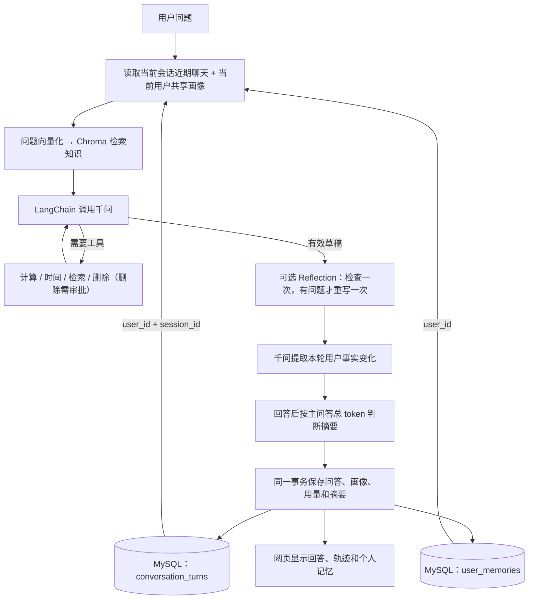

# AI Agent 学习项目

一个最小 Web Agent：加载当前会话摘要与其后全部问答、用户画像 → 自动检索知识库 → 模型按需调用工具 → 可选检查回答 → 提取个人事实 → 回答完成后按需摘要 → 保存本轮状态。

**固定技术栈**：Python + LangChain + 阿里云百炼千问 / Embedding + MySQL（SQLAlchemy ORM）+ Chroma + Streamlit。

阅读入口：[启动](#1-启动项目) · [使用](#2-网页操作) · [工作原理](#3-核心逻辑) · [数据位置](#4-数据位置) · [目录](#5-代码目录) · [验证](#6-测试与评测) · [排查与清理](#7-排查与清理) · [接手理解与开发约定](#8-接手理解与开发约定2026-10-22) · [工具审批](#11-工具权限与人工审批实施记录2026-10-26)

**维护说明（2026-10-22）**：长会话摘要已实现。本项目发生缺列等不兼容结构变更时，按用户明确要求，开发阶段优先清空项目数据库业务表和生成缓存，再按当前代码重建，不要求手工加列或维护旧数据兼容。本次已完成重置，可以直接重新运行；普通启动只创建缺失表，不重复清空数据。

**新手代码精读**：[docs/code-guide/ 总导航](D:/study/AI/ai-agent-demo-study/docs/code-guide/README.md)。为 `agent_demo/` 每个文件提供独立讲解，包含函数参数与返回值、执行流程、关键语法、设计原因及例子，可与源码并排阅读。

**先看全景**：[交互式项目全景图](D:/study/AI/ai-agent-demo-study/docs/code-guide/project-map.html) · [读图方法](D:/study/AI/ai-agent-demo-study/docs/code-guide/project-map.md)。从模块关系下钻到 14 条流程、函数实现和真实源码，可在浏览器独立打开。

## 1. 启动项目

需要 Python 3.11～3.13、已启动的 MySQL，以及百炼问答和 Embedding 模型的访问权限。

首次安装，在 PowerShell 执行；已有 `.venv` 和 `.env` 时保留现有环境与配置：

```powershell
Set-Location D:\study\AI\ai-agent-demo-study
python -m venv .venv
.\.venv\Scripts\python.exe -m pip install -r requirements.txt
if (-not (Test-Path -LiteralPath .env)) {
    Copy-Item -LiteralPath .env.example -Destination .env
}
```

在 `.env` 填写：

| 配置 | 含义 |
| --- | --- |
| `LLM_API_KEY` | 百炼 API Key，问答与 Embedding 共用 |
| `LLM_BASE_URL` | 控制台提供的兼容接口地址，包含 `/compatible-mode/v1`，与密钥地域、业务空间匹配 |
| `LLM_MODEL` | 问答模型，默认 `qwen3.8-flash` |
| `EMBEDDING_MODEL` | 向量模型，默认 `text-embedding-v4` |
| `MYSQL_HOST` / `MYSQL_PORT` | 本机通常为 `127.0.0.1` / `3306` |
| `MYSQL_USER` / `MYSQL_PASSWORD` | MySQL 用户名和密码 |
| `MYSQL_DATABASE` | 数据库名，默认 `agent_demo` |
| `USER_ID` | 固定用户 ID，默认 `local_user`；新建会话不改变它 |
| `CONTEXT_TOKEN_BUDGET` / `SUMMARY_KEEP_TURNS` | 默认 50000 / 6；回答后超过阈值才摘要，压缩时保留最近完整问答，之后原文继续增长 |
| `REFLECTION_ENABLED` | 回答前检查开关，默认 `false`；设为 `true` 并重启后，检查一次，有问题才重写一次 |

程序通过 SQLAlchemy 自动建库、建表和索引，无需手工执行 SQL；新建表使用 `utf8mb4` 保存中文。MySQL 账号需要创建、查询、插入和更新权限。`USER_ID` 允许 1～64 个字母、数字、下划线或连字符；数据库名建议使用字母、数字和下划线。系统同名环境变量优先，修改配置后重启。

新建数据库时两张业务表为空；问答成功后才产生聊天记录和个人记忆。启动过程不会清空已有数据库。

### PyCharm 启动

打开项目，顶部选择 **`AI Agent (Streamlit)`**，点击绿色运行按钮。首次出现 `Email:` 时直接按回车留空，等待打印网址再打开网页。停止时点击红色停止按钮。

项目已提供 `.idea/runConfigurations/AI_Agent_Streamlit.xml`；若需要检查“运行 → 编辑配置”：

| 字段 | 值 |
| --- | --- |
| Python 解释器 | `D:\study\AI\ai-agent-demo-study\.venv\Scripts\python.exe` |
| 目标类型 / 模块名称 | **模块名称** / `streamlit` |
| 参数 | `run app.py --server.address 127.0.0.1 --browser.gatherUsageStats false` |
| 工作目录 | `D:\study\AI\ai-agent-demo-study` |

直接右键以普通 Python 方式运行 `app.py` 无法正常启动网页服务。

### PowerShell 启动

```powershell
Set-Location D:\study\AI\ai-agent-demo-study
.\.venv\Scripts\python.exe -m streamlit run app.py --server.address 127.0.0.1 --browser.gatherUsageStats false
```

保持命令窗口运行，通常访问 [http://127.0.0.1:8501](http://127.0.0.1:8501)，以实际打印地址为准。按 `Ctrl+C` 停止。

## 2. 网页操作

| 功能 | 操作 | 检查结果 |
| --- | --- | --- |
| 计算 / 时间 | `计算 (12+8)*3` / `现在几点？` | 轨迹包含 `calculator` / `current_time`；时间取电脑本地时区 |
| 示例知识问答 | `星舟课程退款需要满足哪些条件？` | 7 天内且学习比例不超过 20%，引用 `course.md` |
| 上传知识 | 展开侧栏“知识库管理”→ 选文件 →“上传并入库”→ 提问 | 返回上传文档来源 |
| 同步知识库 | 手动修改知识原件后，展开“知识库管理”点击“同步知识库” | 新增或变化的切片重新入库 |
| 删除知识 | `删除知识库里的 course.md` → 在审批卡片点“批准执行” | 文件删除、索引同步；点“拒绝”则不删除 |
| 记住信息 | `我叫小明，我的学习目标是掌握 Python` | 展开“个人记忆（所有会话共享）”查看画像 |
| 跨会话回忆 | 点击“新建会话”→ `我叫什么名字？` | 同一用户继续使用已保存的姓名 |
| 更正 / 遗忘 | `更正：我叫小舟` / `请忘记我的姓名` | 共享画像更新 / 标记已遗忘 |
| 恢复聊天 | 在“切换会话”下拉框选择历史会话，立即切换 | 恢复当前用户该会话最近 50 轮记录 |
| 模型用量 | 查看每条回答下方和页面底部 | 输入、输出、总 token、缓存命中率、推理占比、整轮处理耗时 |

侧栏从顶部开始显示会话操作，“知识库管理”默认收起。运行信息直接显示当前用户、模型和数据库名称，无需展开。

每轮用量直接读取模型返回值，包含问答工具循环、可选反思、记忆提取及实际发生的摘要。`usage_json` 保存本轮 `current` 与会话累计 `total`，下一轮复用最后一行累计。缓存率按缓存 token / 输入 token，推理占比按推理 token / 输出 token；字段缺失显示未提供。处理耗时从进入 `chat()` 到保存前，包含检索、工具、反思、提取和摘要；人工审批等待不计入，恢复后的第二次模型调用计入同一轮。Embedding 与未保存失败问答不计入。摘要触发单独看最后一次主问答的总 token，不使用整轮累计。

上传支持 **TXT、MD、PDF、DOCX，每份最多 10 MB**。TXT / MD 使用 UTF-8；PDF 需有可提取文字，扫描文件先 OCR；DOCX 读取正文段落和表格。同名文件更新旧原件，取消文件选择不会删除原件。

**不用加“请查询知识库”**：每轮问题会先自动检索。展开“工具调用轨迹与知识来源”查看原文，首次 `knowledge_search` 标记为 `trigger: automatic`，后续工具由模型选择。`[uploads/notes.txt#0]` 表示该文件第 0 个切片。

## 3. 核心逻辑

### 一轮问答



首次打开网页时，`load_settings()` 读取配置并创建 `Settings`，创建时由 `__post_init__()` 先检查基本范围，最后调用 `validate()` 检查必填项、地址和端口；通过后 `AgentApp` 初始化模型、MySQL 和 Chroma，并同步知识原件。Streamlit 缓存这些资源；普通页面交互复用缓存，重启进程后重新初始化。

`@tool` 注册四个 Python 工具，`create_agent()` 负责模型与工具之间的循环。Python 没有 `ast.eval()`；计算器在 `calculator` 工具里用 `ast.parse()` 解析、检查只含基本算术节点，再用禁用内置函数的 `eval()` 计算，支持 `+ - * / // %`。循环步数上限为 12。一轮可能调用模型多次，轨迹展示实际工具动作。

`delete_knowledge` 是破坏性工具：创建 Agent 时挂上 `tool_policy.build_tool_middleware()`，权限门卫检查白名单和只读工具次数，`HumanInTheLoopMiddleware` 对删除工具暂停；网页批准后，`resume()` 用同一个 `thread_id` 从 checkpointer 恢复，工具才执行。删除工具不设次数上限，审批本身就是控制。一轮通常因此调用两次模型：第一次提出删除，批准后执行，第二次写最终回答。

普通问题只检查是否为空，不设置固定字符上限；非常长的输入仍可能受到模型上下文或接口限制。时间工具和记忆日期使用运行电脑的本地时区，无需单独配置时区。

### Reflection：交卷前检查一次

在 `.env` 设置 `REFLECTION_ENABLED=true`，完整重启网页进程后生效。复用当前千问和密钥，不增加依赖或数据库表。

模型拿着用户问题、近期聊天、处理后的画像和本轮全部工具结果检查草稿。没发现明确问题就保留草稿；发现漏答、无依据的具体事实、错误引用、工具结果冲突或记忆规则问题时，最多重写一次。重写只使用已有材料，不再执行工具。

开启后通常多一次检查请求，有问题再多一次重写；原有记忆提取仍照常执行。检查或修订失败时保留草稿，并在“答案检查”里显示未完成状态及已发现的问题；成功修订也不代表经过第二次模型复审。

网页可展开“答案检查”，对照草稿和问题列表。检查记录沿用 MySQL 的 `trace_json`；聊天正文只保存最终选用的答案，用户画像仍从用户原话提取。具体函数讲解见 [reflection.py：交卷前的检查员](D:/study/AI/ai-agent-demo-study/docs/code-guide/reflection.md)。

### 用户与会话

| 对象 | 标识 | 作用 |
| --- | --- | --- |
| 当前用户 | `.env` 的 `USER_ID`，默认 `local_user` | 决定读取哪份个人画像，以及能查看哪些聊天 |
| 当前会话 | 网页生成的 `session_id` | 决定本轮加载哪段近期聊天，点击“新建会话”时更换 |

**同一用户的新旧会话共用画像，原始聊天分别保存。** 每轮重新读取数据库，所以在 B 会话更正姓名后，回到 A 会话提问也能读到新值；更正和遗忘作用于该用户的所有会话。模型被要求优先使用最新画像，避免旧聊天中的过时信息干扰回答。

模型上下文采用当前会话累计摘要与覆盖位置之后的全部问答。尚无摘要时，读取当前用户、当前会话全部问答；没有固定 6 轮或字符截断。页面仍显示最近 50 轮，原始聊天全部保存在 MySQL。摘要只在当前会话使用，个人画像继续跨会话共享。目前没有窗口外原始聊天检索工具。下拉框继续使用稳定完整会话 ID，轮数与保存时间单独显示。

这是本机单人学习项目，没有登录系统。换一个 `USER_ID` 并重启，可以测试用户之间的聊天和画像隔离；知识文档仍然共用。固定 ID 是数据归属标识，不是密码或登录认证。

### MySQL ORM 读写

所有聊天和画像读写集中在 `agent_demo/memory.py`，使用 SQLAlchemy ORM：一行数据对应一个 Python 对象。

| 对象 / 操作 | 项目中的写法 |
| --- | --- |
| 聊天模型 / 画像模型 | `ConversationTurn` → `conversation_turns`；`UserMemory` → `user_memories` |
| 新增 | 创建模型对象 → `session.add(对象)` |
| 按主键查询 | `session.get(UserMemory, user_id)`；找不到返回 `None` |
| 条件查询 | `select(ConversationTurn).where(...)` → `session.scalars(...).all()` |
| 修改 | 给已查询对象的属性赋值，例如 `profile.facts_json = 新字典` |
| 事务 | `with self.session_factory.begin() as session:` 正常结束提交，异常时回滚 |

`session.flush()` 提前执行待保存操作，以取得聊天自增 ID；它不提交事务。问答与画像在同一事务中保存，画像按用户加行锁后合并，防止并发覆盖。查询方法在 Session 关闭前转成普通字典，网页和 Agent 的调用方式保持一致。

建库、建表使用 `CreateSchema` 和 `Base.metadata.create_all()`；`create_all()` 只建缺失表。缺列等结构不兼容问题，按本项目用户偏好，由开发阶段重置项目两张业务表和生成缓存，再按当前 ORM 模型重建，不增加迁移兼容逻辑。普通启动仍保留数据。

### 结构化记忆：什么时候保存与更新

采用小规模 **Profile（事实画像）+ 增量更新**，每个用户一份 MySQL JSON，最多 20 个字段（含弃用标记），每个值最多 200 字。每轮直接加载画像，不增加记忆向量库或后台任务。

| 规则 | 实现 |
| --- | --- |
| 提取时机 | 每轮有效回答后，同步调用现有千问一次；无变化返回空列表 |
| 提取内容 | 用户明确陈述的个人事实、偏好、目标和明确要求记住的信息；问题、猜测、文档和助手回答不作为新事实 |
| 合并方式 | 复用同义字段名，同字段覆盖，未提及字段保留；重复确认刷新来源和记录时间 |
| 来源 | `source_turn_id` 指向提供或更正事实的原始问答 |
| 时间 | `recorded_at` 带时区；明确期限保存 `expires_on`，截止日当天有效，次日停用；没有期限不设置任意过期时间 |
| 年龄 | 保存自述年龄和日期，不推算生日或精确当前年龄 |
| 遗忘 | 用户明确要求忘记时清空事实值，保留已遗忘标记；原始聊天仍保留 |
| 失败 | 提取、格式校验或容量检查失败，保留原画像，保存原始问答并显示警告 |

提取使用 LangChain 的结构化输出和 Pydantic 校验，每条变化必须引用本轮用户原话。事实语义和同义字段合并仍由模型判断，可在网页核对、更正。提取多一次模型请求，会增加等待时间与费用，复用已有密钥。

画像上下文只包含处理后的事实，不附加每轮变化的当前时间；需要当前日期或时间时调用时间工具。`now` 仍用于按真实日期判断过期。过期或遗忘的事实值不进入画像上下文，保留状态标记并要求模型不要从旧历史恢复为现状；用户重新明确提供时才更新。**遗忘不等于删除原始聊天或知识文档**。期限按天处理，不支持小时级自动过期。

参考：[LangChain 记忆](https://docs.langchain.com/oss/python/concepts/memory) · [百炼 Function Calling](https://help.aliyun.com/zh/model-studio/qwen-function-calling)。

### 知识库：上传、同步、删除与向量化

```text
知识原件 → 提取正文 → 400 字符切片（重叠 60）→ 比较切片 ID
        → 新增切片调用 Embedding → 存入 Chroma → 删除过时切片

每轮问题 → 问题 Embedding → 相似检索 → 带来源原文 → 模型回答
```

`docs/knowledge/` 和 `data/uploads/` 是两个原件入口，进入同一个知识集合。上传后自动同步；手动改文件后点击同步。读取原件、切片与更新索引共用同一把进程内锁，避免交错同步用旧内容覆盖新索引。

**重启会同步，但不会重复向量化未变化的文档。** 切片 ID 由来源、编号和内容计算；新建、修改、改名的切片才重新向量化，已删除的切片移出索引。删除 Chroma 目录或更换向量模型 / 接口地址会重建索引。

**删除知识文档**：`delete_knowledge(source)` 可以删预置资料（如 `course.md`）或上传文件（如 `uploads/notes.txt`），但会拒绝绝对路径、`..` 和知识目录之外的路径。它删原件后调用 `ingest()`，靠指纹把旧切片移出索引。删除最后一份文档时，`ingest()` 清空全部旧切片并返回 0；`retrieve()` 空库返回空列表，`context()` 返回“知识库为空”，后续问答不会崩。删掉的预置资料可用 git 恢复，但依赖它的评测题会暂时失败。

每轮提问仍会产生问题 Embedding 请求，包括计算和闲聊。文档切片和问题发送给百炼 Embedding，检索证据和上下文发送给千问。自动检索保证查询发生，不保证命中正确事实；接口异常会中止本轮。

## 4. 数据位置

以下文件位置均相对于项目根目录 `D:\study\AI\ai-agent-demo-study`。

| 内容 | 保存位置 |
| --- | --- |
| 密钥、数据库配置、固定用户 ID | `.env` |
| 预置资料 | `docs/knowledge/agent.md`、`course.md` |
| 上传原件 | `data/uploads/<原文件名>` |
| 文档切片、向量与来源 | `data/chroma/`，集合名 `learning_<12位哈希>` |
| 原始问答、工具轨迹、反思和模型用量 | MySQL：`<MYSQL_DATABASE>.conversation_turns` |
| 跨会话共享画像 | MySQL：`<MYSQL_DATABASE>.user_memories` |
| 真实评测文件和报告 | `data/evaluation/<运行ID>/` |
| 运行日志与完整异常堆栈 | `data/logs/app.log`，单份 5 MB，保留 3 份备份 |
| Windows 进程临时文件 | 当前把进程的 `TEMP` / `TMP` 指向 `data/tmp/`，与向量索引一起放在 `data` 中 |

MySQL 只有两张业务表，默认库名为 `agent_demo`：

| 表 | 主要字段 |
| --- | --- |
| `conversation_turns` | `id INTEGER` 自增主键；`user_id VARCHAR(64)` 用户；`session_id VARCHAR(64)` 会话；`user_text TEXT` 问题；`assistant_text TEXT` 回答；`trace_json LONGTEXT` 工具与反思的 JSON 文本；`usage_json JSON NULL` 本轮与会话累计用量；`summary_json JSON NULL` 摘要正文与覆盖位置；`created_at DATETIME` 保存时间 |
| `user_memories` | `user_id VARCHAR(64)` 主键；`facts_json JSON` 画像；`updated_at DATETIME` 最后写入时间 |

画像中的每条事实包含 `value`、`recorded_at`、`expires_on`、`source_turn_id`、`forgotten`。网页的有效 / 已过期 / 已遗忘状态在读取时计算。聊天表索引 `ix_user_session_id` 按用户、会话和记录顺序查询；用户 ID 区分大小写。

在 DBeaver 选择本项目数据库，展开表的数据页，或执行：

```sql
SELECT id, user_id, session_id, user_text, assistant_text, created_at
FROM conversation_turns
WHERE user_id = 'local_user'
ORDER BY id DESC LIMIT 20;

SELECT user_id, facts_json, updated_at
FROM user_memories WHERE user_id = 'local_user';
```

上传文件不写入 MySQL，聊天也没有向量化。`data/chroma/chroma.sqlite3` 是 Chroma 的内部文件，与索引子目录一起组成向量库；备份时保存整个目录。问题向量只用于当次检索。

## 5. 代码目录

```text
ai-agent-demo-study/
├── app.py                       # 网页：聊天、共享画像、上传、会话控制
├── evaluate.py                  # 真实服务评测，使用独立评测用户
├── requirements.txt             # 固定依赖版本
├── .env.example / .env          # 配置模板 / 本机配置
├── .idea/runConfigurations/
│   └── AI_Agent_Streamlit.xml    # PyCharm 启动配置
├── agent_demo/
│   ├── config.py                # 读取和检查配置、固定用户 ID
│   ├── logging_config.py        # 标准库日志：文件、控制台、轮转与完整堆栈
│   ├── llm.py                   # 百炼千问客户端
│   ├── tools.py                 # 计算、时间、知识检索、删除
│   ├── tool_policy.py           # 工具白名单、次数上限与人工审批
│   ├── agent.py                 # 加载记忆、工具循环、审批暂停/恢复、保存
│   ├── reflection.py            # 可选答案检查与独立历史摘要函数
│   ├── usage.py                 # 直接加总返回的 token，生成本轮与会话累计
│   ├── memory.py                # ORM、聊天画像与摘要快照读写
│   ├── structured_memory.py     # 提取事实、增量合并、过期与弃用
│   ├── documents.py             # 文件校验、保存、正文提取
│   ├── embeddings.py            # 百炼 Embedding，每批最多 10 条
│   └── rag.py                   # 切片、Chroma 同步、检索与删除
├── docs/
│   ├── knowledge/              # 预置 Agent 笔记、虚构课程资料
│   └── code-guide/             # 逐文件深度讲解与阅读导航，不自动进入知识库
├── tests/                       # ORM 事务、协议、文档、记忆规则、工具权限/审批和网页交互测试
├── .venv/                       # 本机依赖环境
└── data/                        # 运行后自动生成
```

推荐阅读顺序：`llm.py → tools.py → tool_policy.py → agent.py → memory.py → structured_memory.py → documents.py → embeddings.py → rag.py → app.py`。

代码中的类和函数头有中文说明，可按下面的入口对照上文流程阅读：

先看类头了解它管理什么数据，再看函数头的“参数”和“返回”；类型同时写在函数签名中。`None` 表示函数只修改状态或保存数据，不返回业务结果。

| README 流程 | 从哪个函数读起 | 接下来发生什么 |
| --- | --- | --- |
| 启动项目 | `app.py:main()` → `get_app()` → `config.py:load_settings()` | 缓存 `AgentApp`，检查配置并初始化资源，再绘制页面 |
| 一轮问答 | `agent.py:AgentApp.chat()` → `tools.py:build_tools()` | 读近期聊天和画像、自动检索，再由 LangChain 按需调用工具 |
| 工具审批 | `tool_policy.py:build_tool_middleware()` → `agent.py:AgentApp.resume()` | 删除工具暂停；网页批准/拒绝后从同一 `thread_id` 恢复 |
| 删除知识 | `tools.py:delete_knowledge()` → `rag.py:KnowledgeBase.delete()` | 删原件、`ingest()` 清切片；空库也可继续问答 |
| 用户与会话 | `memory.py:ConversationMemory.context()` / `profile()` | 聊天按用户和会话读取，画像只按用户读取 |
| 结构化记忆 | `structured_memory.py:extract_changes()` → `memory.py:save_turn()` | 模型提取本轮变化，MySQL 同一事务保存问答和画像 |
| 回答检查 | `reflection.py:reflect_answer()` | 开启时检查草稿，有问题才重写，保留状态和原稿 |
| 模型用量 | `usage.py:summarize_usage()` | 读取本轮模型返回值，加上会话最后一轮累计，一起存库和展示 |
| 知识库 | `documents.py:load_documents()` → `rag.py:KnowledgeBase.ingest()` | 提取原文、切片、向量化并写入 Chroma |
| 检索回答 | `rag.py:KnowledgeBase.context()` → `agent.py:AgentApp.chat()` | 问题向量检索，证据附在本轮提问后交给模型 |
| 测试与评测 | `evaluate.py:run_evaluation()` | 用独立用户测试真实服务并写报告 |

## 6. 测试与评测

### 手动验证跨会话共享

1. 保持 `USER_ID=local_user`，在会话 A 说：`我叫晨星，我的学习目标是掌握 Python`。检查共享画像及保存提示。
2. 点击“新建会话”得到 B，直接问：`我叫什么名字？我的学习目标是什么？`。B 没有 A 的聊天记录，但能使用同一份画像。
3. 在 B 说：`更正：我叫小舟`。在下拉框选回 A 再问姓名，应读取更新后的值。
4. 在任一会话说：`请忘记我的姓名`，检查画像值为空、状态为已遗忘，学习目标仍保留。
5. 停止并重启程序，检查同一用户画像仍在。更换 `USER_ID=another_user` 后重启，聊天列表和画像应为空；换回原 ID 可恢复。

测试信息只在聊天里提供，不上传到公共知识库。摘要与未压缩原文的边界、超过 6/50 轮读取和失败恢复优先用虚构数据的本地测试验证；真实评测临时调低独立评测应用阈值，通过真实 `chat()` 触发摘要后恢复配置。临时计划可说“仅在今天有效”，检查画像期限。

### 自动测试

```powershell
# 本地测试：模拟外部服务，不调用百炼，不连接 MySQL
.\.venv\Scripts\python.exe -m pytest -q

# 真实评测：调用百炼、向量化示例资料并写入 MySQL
.\.venv\Scripts\python.exe evaluate.py
```

本地测试覆盖工具、文件、结构化输出协议、事实合并、更正、时间、弃用、跨会话加载、删除知识、空知识库、工具权限/审批和页面反馈。`tests/test_memory_orm.py` 还使用临时内存数据库验证真实 ORM 的增改查、JSON 保存和事务回滚，不读取 `.env`，不增加应用运行模式；MySQL 特有的行锁不由该内存测试验证。真实评测还检查 MySQL 重连、跨会话问答、用户隔离与上传问答；评测环境没有人工，遇到待审批操作会自动拒绝并继续。

真实评测自动使用 `eval_<运行ID>` 用户、独立向量目录和会话，不修改网页用户的画像。报告位于 `data/evaluation/<运行ID>/report.json`；全通过退出码为 0，否则为 1。结合答案、工具证据和 `memory_warning` 判断结果，关键词断言可能误判同义表达。

## 7. 排查与清理

| 现象 | 检查 |
| --- | --- |
| 没有网页 / 停在 `Email:` | 按回车，等待网址；确认进程仍运行 |
| PyCharm 启动不对 | 选择 `AI Agent (Streamlit)`，解释器使用项目 `.venv` |
| 模型鉴权失败 | 密钥、接口地域、业务空间、模型权限 |
| Chroma 报 `unable to open database file` | 检查索引目录和 `data/tmp` 是否可写；源码已在 Windows 下把 `TEMP` / `TMP` 指向 `data/tmp`，查看完整日志 |
| MySQL 失败 | 服务、端口、账号密码、创建与更新权限 |
| 上传失败 | 格式、UTF-8、10 MB 限制，PDF 是否需要 OCR / 解密 |
| 知识答案不符 | 检索轨迹的原文是否包含所问事实，入库是否成功 |
| 删除后知识库为空 | 正常状态；`context()` 会提示“知识库为空”，重新上传或同步即可 |
| 页面停在审批卡片 | 点“批准执行”或“拒绝”；程序重启后待审批会失效，重新提问即可 |
| 个人记忆未更新 | 检查黄色警告、Function Calling 权限、20 字段容量及画像内容 |
| 新会话不记得信息 | 是否仍是同一个 `USER_ID`；上一轮是否成功提取并保存画像 |
| 第二条消息报会话 ID 格式错误 | 更新后重启并重新选择已保存会话；下拉框使用稳定 ID，轮数与时间单独显示，不需要删除聊天数据 |
| 找不到旧聊天 | 当前用户与会话 ID 是否正确；空会话尚未保存 |

可调参数在 `.env.example`：`CONTEXT_TOKEN_BUDGET=50000`、`SUMMARY_KEEP_TURNS=6`、`RAG_TOP_K=3`、`RAG_MAX_DISTANCE=0.8`。前两项决定回答后的摘要触发及每次压缩保留的原文轮数；之后原文继续增长。旧的 `MEMORY_TURNS`、`MEMORY_CHAR_BUDGET` 已不再读取。摘要不受答案检查开关控制，也没有长度配置。

清理前停止 Streamlit。删除 `data/uploads/` 后同步可移除上传知识；也可以在聊天里让 Agent 调用 `delete_knowledge`（需审批）删单份文档。删除 `data/chroma/` 会在下次启动重新向量化现存原件；删除 `data/evaluation/` 清理评测文件。删除整个 `data/` 可清空本地运行数据，但不会删除 MySQL 数据。`__pycache__/`、`.pytest_cache/` 是可重新生成的缓存。

若需要再次清空所有用户的聊天和画像，在 DBeaver 选中本项目数据库后执行并提交：

```sql
DELETE FROM user_memories;
DELETE FROM conversation_turns;
```

保留源码、`.env`、`.venv` 和预置知识原件即可重新运行。首次重建知识库会把预置资料发送给百炼 Embedding。项目绑定 `127.0.0.1`，用于本机学习。

### 缺列或结构不兼容时，优先重置项目数据

本项目是最小学习实现。用户已明确要求：后续遇到缺列、表结构与代码不兼容或关联缓存不一致等同类问题，优先清空本项目数据库数据和生成缓存，按当前代码重新开始，不要求手工迁移旧数据。

开发阶段先核实 `.env` 与运行配置实际指向的项目数据库、业务表和数据目录，停止占用缓存的项目进程；重建 `conversation_turns`、`user_memories`，清理 Chroma、临时文件、旧日志及项目 Python / pytest 缓存，最后核对当前列与空表状态。源码、`.env`、`.venv` 和知识原件继续保留。

这是一项结构变更后的开发重置操作，普通启动仍只创建缺失表，不能每次运行都删除聊天。已移除手工加列报错与对应 SQL 文件，本次数据库和缓存重置已经执行，可以直接重新运行。

### 查看完整错误日志

网页与评测入口使用 Python 标准库 `logging`，无需安装额外依赖。页面保留简短错误提示，完整异常堆栈写到 `data/logs/app.log`，同时输出到控制台；反思、记忆提取等捕获后继续运行的异常也会记录。单份约 5 MB，最多保留 `app.log.1`～`.3` 三份备份，重启继续追加。

```powershell
Get-Content ./data/logs/app.log -Tail 100 -Encoding UTF8
```

Windows 下 Chroma 会用到临时文件。项目在启动时把当前进程的 `TEMP`、`TMP` 指向 `data/tmp`，与向量索引一起放在 `data` 中，方便排查和清理。首次初始化失败后，应停止旧进程再运行，刷新页面不能保证释放 Chroma 的失效内部对象。

日志包含异常原文，分享前检查需要遮掉的信息；清理日志或 `data/` 前先停止项目。逐行讲解见 [logging_config.py：本地故障记录](D:/study/AI/ai-agent-demo-study/docs/code-guide/logging_config.md)。

## 8. 接手理解与开发约定（2026-10-22）

### 项目的目标与作者要求

这是一个用于学习和阅读的本机 Agent 项目。后续功能继续围绕“最小实现”展开：**代码和语法尽量简单，每个功能形成一个能解释清楚、能运行、能验证的完整流程。** 这是用户明确提出的长期要求，后续开发以此为依据。

具体执行时遵守以下约定：

1. **先保留直观的主流程。** 读者应能沿着 `main()` 和 `AgentApp.chat()` 看懂执行顺序；优先普通函数、显式判断与循环。只有实际职责需要时再增加类或文件。
2. **每次围绕明确功能做必要改动。** 复用当前客户端、配置、存储和统计入口；通用管理器、多层继承、插件框架、后台任务等需要有具体需求支撑。
3. **沿用固定技术栈。** Python、LangChain、百炼千问与 Embedding、MySQL ORM、Chroma、Streamlit。测试中的内存 SQLite 和假模型只用于验证，不构成应用的另一种运行模式。
4. **注释帮助理解原因。** 函数保留类型标注和中文用途、参数、返回说明；重点解释数据归属、调用顺序、状态变化和失败处理。详细语法与完整例子放到 `docs/code-guide/`，保持源码易读。
5. **功能的失败结果要准确。** 沿用“可选检查失败用草稿、画像提取失败保留问答”的局部降级；检索、主回答或最终数据库保存失败时明确报错。新增能力分别确定失败边界，不机械套用“所有错误都继续”。
6. **按用户偏好处理结构变更。** 普通问答、切换会话和重启保留数据，遗忘仍只弃用画像；遇到缺列等不兼容结构变更，优先清空本项目业务表和生成缓存，再按当前代码重建。重置由开发阶段执行，不放进每次启动流程；保留源码、配置、依赖环境与知识原件，不操作其他项目或数据库。
7. **代码与教学资料一起维护。** 改动影响到的配置模板、测试、逐文件讲解、全景图及其嵌入源码应同步检查。路线图写清是否实施，发现旧文档与源码冲突时记录实际状态。

这些约定允许使用当前必要的 ORM、Pydantic、闭包和库接口，重点是让每一处复杂度都能解释其用途。功能是否增加开关，也按该功能的实际使用方式决定。

### 我对整体实现的理解

项目的主干是一个同步问答流程，`AgentApp` 持有配置、问答客户端、记忆读写器与知识库。LangChain 的 `create_agent()` 管模型与工具的往返循环；本项目显式处理循环前后的材料准备、结果校验和持久化。

```text
页面提交问题
  → 校验输入，读取当前会话近期问答与上轮累计
  → 读取当前用户共享画像，隐藏过期或遗忘值
  → 程序自动检索知识库一次
  → 固定规则＋画像＋历史＋本轮问题和证据交给模型
  → LangChain 执行模型选择的工具，取得有效草稿
  → 开启反思时检查一次，有问题才重写一次
  → 只从本轮用户原话提取个人事实变化
  → 汇总本轮模型返回用量与处理耗时
  → 短事务保存问答、轨迹、用量和画像变化
  → 页面重跑，从 MySQL 重新读取并展示
```

模型客户端本身不保存聊天。资料能影响回答，是因为程序在本轮请求中明确传入。聊天、画像、知识和统计分别承担不同职责：

| 数据 | 归属与保存方式 | 进入主问答上下文的方式 |
| --- | --- | --- |
| 原始问答 | MySQL `conversation_turns`，按 `user_id + session_id` | 有摘要则读取覆盖位置之后全部问答，没有摘要则读取本会话全部原文 |
| 个人画像 | MySQL `user_memories`，每个 `user_id` 一份 JSON | 每轮重新读取，作为资料消息紧接摘要；失效字段隐藏值、保留状态 |
| 知识资料 | `docs/knowledge/`、`data/uploads/` 原件与 Chroma 索引，项目共享 | 本轮自动检索，以及模型选择的补充检索 |
| 工具与反思轨迹 | `trace_json` JSON 文本 | 本轮工具结果可参与回答与反思；下轮不重放旧工具消息 |
| 模型用量 | `usage_json` 原生 JSON，保存 `current` 和 `total` | 用于展示和下一轮累计，不发给模型 |

值得保留的实现选择：

- **工具只有四件。** `calculator`、`current_time`、`knowledge_search`、`delete_knowledge`。模型填写工具名和参数，Python 执行；每轮的第一次知识检索由程序直接执行，并标记 `trigger: automatic`。`recursion_limit=12` 限工作流步数。
- **权限与审批固定在代码里。** `tool_policy.py` 的白名单和次数上限始终生效；`delete_knowledge` 每次都要人工批准，没有 `.env` 开关。审批用 `InMemorySaver` 保存暂停现场，批准/拒绝后恢复同一轮。
- **画像以增量更新。** 提示模型优先复用已有字段名，Pydantic 校验结构，程序检查重复字段、证据子串及动作规则；最多 20 个字段，遗忘标记也占容量。引用存在不能证明语义正确，同义字段归一与事实判断仍依赖模型。
- **保存集中在一个地方。** `memory.py` 负责 ORM；画像变化与问答同事务保存，`flush()` 后取得真实来源 ID，锁后重读最新画像再合并。容量错误回滚后只重存问答和同一份用量；网络模型调用发生在保存事务之前。
- **RAG 对原件全量扫描，对向量增量更新。** 切片指纹包含来源、编号、内容；只向量化新增片段，成功添加后才删过时片段。上传、同步与检索共用进程内 `RLock`。上传文件和向量更新不构成数据库事务，向量化失败后原件仍保留。
- **反思有明确上限。** 默认关闭，开启后检查一次、最多重写一次，只使用已有材料；失败保留草稿与准确状态。程序还检查引用编号是否来自本轮检索，但这不能证明引用语义正确。
- **统计直接使用返回值。** 工具循环、反思、画像提取的原始模型消息共同计入；缺失值保留未知。会话累计复用最后一轮快照，适用于同一会话顺序提问。画像行锁并未解决同一会话并发请求的累计覆盖问题。
- **页面保持薄。** `session_state` 记当前会话，`cache_resource` 复用应用，MySQL 保存聊天。会话控件使用稳定完整 ID，轮数和时间单独显示；页面最近 50 轮与模型上下文窗口分别处理。

### 已实现与待开发的分界

当前已实现：四工具、工具白名单与次数限制、删除工具人工审批、自动 RAG、上传与增量索引、空知识库处理、当前会话累计摘要与完整未压缩尾部、跨会话画像、可选一次反思、包含摘要的用量累计、本地日志及页面和评测入口。

当前没有：窗口外原始聊天检索工具、显式规划执行、多 Agent 编排、断点续跑、持久化 checkpointer、登录身份与审计系统。计算器自身 AST 白名单仍有效，完整可观测性扩展仍暂缓。

本次已按用户修订完成 [长会话摘要与缓存方案](D:/study/AI/ai-agent-demo-study/docs/roadmap/conversation-summary-cache-handoff.md)：回答完成后按主问答最后一次总 token 严格超过 50000 判断；`reflection.py` 中的普通摘要函数独立于答案检查，应用不限制摘要长度；快照随聊天行保存。消息顺序为固定规则、摘要、当前画像、未压缩历史、本轮问题与 RAG。画像变化会影响其后历史的共同前缀，缓存命中率不作保证。

[六项技术扩展备忘](D:/study/AI/ai-agent-demo-study/docs/roadmap/agent-extension-plan.md) 继续作为历史学习参考，当前实现以代码、本文与已同步的摘要交接为准。知识库文章提到某项技术不代表项目已实现全部能力。

### 已核实的差异与后续注意点

| 位置 | 当前实际状态 | 后续处理依据 |
| --- | --- | --- |
| `memory.py:context()` | 本次已替换旧字符预算与固定窗口，改为摘要及其后全部原文；旧测试已改为新行为断言 | 已完成 |
| `rag.py:KnowledgeBase.__init__()` | Windows 下把 `TEMP` / `TMP` 指向 `data/tmp`；对应 Windows 测试已通过 | 已与源码一致 |
| `docs/knowledge/agent.md` | 本次修正过时的历史检索工具描述，说明会话摘要和跨会话画像 | 下次正常启动时由已有增量入库同步 |
| 根目录文档导航 | 部分讲解、提示文字和路线图仍引用不存在的根 `README.md` | 当前根入口是本文件；后续文档维护统一修正导航 |
| `docs/code-guide/project-map.html` | 本次同步摘要链路与当前源码快照 | 以后改代码仍需同步更新 |

首次通读阶段保留了生产代码；本轮按已确认方案实施短期记忆改造。Windows 临时目录分支继续保持原状，未把无关故障修复混入本次功能。

### 验证方式与本次基线

本地 `pytest` 使用虚构配置和模拟模型，不读 `.env`、不连百炼或 MySQL；其中也有真实内存 ORM、真实文件解析、Streamlit 页面及本地 Chroma 验证。内存 SQLite 不能证明 MySQL 行锁的实际并发效果。

`evaluate.py` 是另一条真实服务验证入口：当前默认 13 项，开启反思共 15 项。独立评测用户与目录仍连接配置的 MySQL、调用百炼并留下评测数据；摘要评测通过临时降低阈值触发真实调用，不再用占位聊天冒充摘要验证。本轮未执行真实服务评测。

首次接手阅读时使用项目 `.venv` 实测，并给 pytest 指定项目内的独立临时目录，避免沙箱默认临时路径的权限问题。结果如下，**不是全量通过**：

| 验证范围 | 结果 | 解释 |
| --- | --- | --- |
| 排除页面测试及 Windows Chroma 专项后的本地测试 | 103 通过、2 失败 | 两项失败均为历史字符预算断言，与当前停用字符截断的源码状态一致 |
| 单独运行 Windows Chroma 专项 | 1 失败 | 构造 Chroma 时出现 SQLite code 14：`unable to open database file`；测试故意设置了不存在的 `TEMP/TMP`，当时源码中该分支未启用 |
| Streamlit AppTest 页面相关测试 | 未完成 | 当前受限执行环境中，事件循环初始化停在 Python `socket._fallback_socketpair()` 的 `accept()`；取得超时调用栈后中止，尚不能据此判断页面逻辑通过或失败 |

三个已运行失败项的完整名称：

- `tests/test_memory_orm.py::test_context_keeps_cumulative_usage_even_when_no_history_fits`
- `tests/test_memory_orm.py::test_history_context_preserves_complete_pairs_within_character_budget`
- `tests/test_rag.py::test_windows_chroma_uses_local_temp_and_works_without_network`

以上是首次阅读阶段的历史基线；本轮实现与最新验证记录见第 9 节。

## 9. 短期记忆改造实施记录（2026-10-22）

已实现读取累计摘要及覆盖位置之后全部原文，未摘要时读取当前用户、当前会话全部问答；页面仍显示最近 50 轮。摘要快照保存在 `conversation_turns.summary_json`，包含 `text` 与程序确定的 `through_turn_id`。

正常摘要在回答完成后判断最后一次主问答返回的输入加输出总 token，严格大于 50000 才调用 `reflection.py:summarize_history()`；等于不触发。应用不额外限制摘要输出长度。压缩时默认保留最近 6 轮完整问答（含本轮），随后原文继续增长。

消息顺序为固定规则、历史摘要、当前画像、未压缩问答、本轮问题与检索资料。反思接收相同摘要，画像提取继续只认本轮用户原话。摘要原消息纳入现有用量；失败保留旧摘要和旧游标；画像容量回滚后的备用路径保留同一份摘要与用量。

少数超长问答已经超过阈值、但优先保留 6 轮会导致没有可压缩范围时，改为总结全部完整旧问答，仅保留本轮原文。应用不截断半轮，也不重复循环摘要。

新增和改动的代码逐行提供中文注释。源码、测试、配置模板、代码精读和全景图同时更新。摘要改造阶段未调用付费模型；此前的手工加列要求已按用户修订移除，实际数据库重置结果见第 10 节。

第一版正常压缩仅在回答完成后触发，未加入发送前自动摘要或分词器；旧会话首次读取和超长新输入仍受实际模型服务长度限制，失败按现有报错路径处理。同一会话按顺序提问，尚未实现多页面同时提交的快照协调。

摘要改造回归基线为 160 项通过，另有 1 项既有 Windows Chroma 临时目录测试报 SQLite code 14。源码逐行注释、Python 语法和全景图跳转均已核对。本次后续已实际重置 MySQL，真实付费模型评测仍未执行。

## 10. 数据重置处理约定与执行记录（2026-10-22）

用户明确要求：后续遇到类似缺列或不兼容结构问题，优先清除本项目缓存数据和数据库数据，重新运行，避免旧状态与当前代码不一致。此要求取代先前的手工加列和优先保留旧数据方案。

本次已核实数据库为本机 `agent_demo`，只有项目两张业务表；重置前为 4 轮聊天、1 份画像。已停止该项目 Streamlit 进程，删除并按当前 ORM 重建两张表；重置后两表均为 0 行，`summary_json` 列已存在。

已清理 `data/chroma/`、`data/tmp/`、`data/logs/` 与项目 Python 缓存；不存在的评测目录和 pytest 缓存无需处理。保留源码、配置、依赖环境、知识原件及修改前源码快照。内存资源缓存随项目进程停止释放。

启动代码已移除缺列时要求执行 SQL 的检查；正常启动只建缺失表。后续同类结构变更继续在开发阶段先重置项目数据，再让用户重新运行。

重置后已实际创建 `ConversationMemory` 验证初始化成功，两表仍为 0 行，当前会话上下文与用户画像均为空；对应 ORM 本地回归 17 项通过。未启动 Streamlit 或调用付费模型，用户可自行重新运行。

## 11. 工具权限与人工审批实施记录（2026-10-26）

新增 `delete_knowledge` 工具、`tool_policy.py` 和两段式审批流程。权限策略固定在代码里，没有新增 `.env` / `config.py` 开关。

| 项目 | 当前实现 |
| --- | --- |
| 白名单与次数 | `TOOL_POLICIES`；只读工具 10/3/5 次上限，删除工具不限次数；未知工具拒绝 |
| 审批 | `HumanInTheLoopMiddleware` 只拦截 `delete_knowledge`，批准/拒绝由网页按钮触发 |
| 暂停存档 | `InMemorySaver`，`thread_id=session_id`；程序重启后待审批作废 |
| 一轮两段 | `chat()` 返回 `pending_approval`；`resume()` 复用同一张 Agent 图，用 `Command(resume=...)` 继续；`_finish_turn()` 统一收尾，工具计数跨暂停保留 |
| 删除范围 | 预置与上传文档都可删；拒绝绝对路径、`..` 和知识目录外路径 |
| 空知识库 | `ingest()` 清空旧切片并返回 0；`retrieve()` 返回空列表；`context()` 提示“知识库为空” |
| 审批记录 | 轨迹中追加 `kind="approval"` 条目，记录批准/拒绝和参数 |
| 评测 | 无人在场，遇到待审批自动拒绝并继续，避免评测中断 |
| 未做 | 持久化 checkpointer、登录身份、企业审计、`source="all"` 批量删除 |

删除预置资料会真删 `docs/knowledge/` 原件；可用 git 恢复，但恢复前依赖它的评测题会失败。删除最后一份文档后应用仍可运行，只是知识问答没有证据。

验证：`pytest -q` 共 **179 项通过**，其中包含真实 LangChain HITL 的假 HTTP 集成测试（首次调用暂停、批准后工具只执行一次）和 Streamlit 审批卡片测试；未调用百炼、未连接真实 MySQL，也未执行付费评测。`project-map.html` 按用户要求未同步，仍是旧源码快照。

同一轮还整理了异常边界：最终回答检查和摘要状态检查各合并为一次；去掉 `save_turn()` / `context()` 的重复会话校验和不可达的画像异常；页面把上传与同步的错误处理统一到侧栏入口，操作函数只负责成功路径。
